

  

# PR Guard

PR Guard is an AI code reviewer that lives on GitHub. Install it on an organization and it reviews
every pull request and every new push. It posts a short summary, comments on the exact lines that
need attention, and ranks everything by how much it matters. It only comments: a human always stays
the one who approves and merges.

A dashboard shows reviews as they run, a queue of open pull requests ranked by urgency, and how
useful each reviewer has been.

**In one minute**

- 10 focused AI reviewers (bugs, security, reliability, and more) plus 2 plain-code checks
  (leaked secrets, malicious packages).
- Every finding is re-checked against the real code before it is posted, so the PR is not flooded
  with guesses.
- Each pull request gets a **priority** (P0 to P3) and a **risk level**, with the reasons.
- People talk to it in the PR: `@prguard explain`, `@prguard fix`, `@prguard ignore`, or any question.
- It learns. When the team says "this is fine", the same kind of finding stops showing up.
- When a later push fixes a finding, its comment is marked Fixed and folded away.

## What it looks like on GitHub

  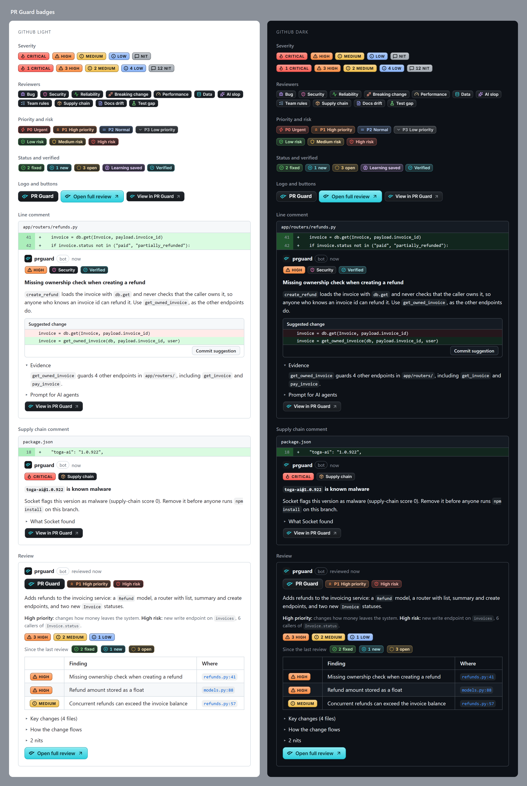

Line comments carry badges for severity and reviewer, a one-click suggested fix, the evidence it
was checked against, and a ready-made prompt you can paste into an AI coding agent. The review on
top summarizes the change, its priority and risk, and a table of everything found.

## How it fits together

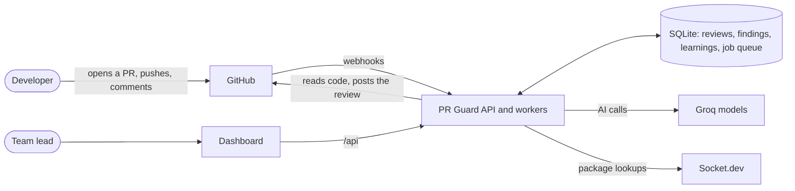

| Part | What it is |
| --- | --- |
| `apps/api` | Receives GitHub events, runs reviews in a background queue, serves the dashboard's data |
| `apps/dashboard` | The web app teams sign into with GitHub |
| `apps/web` | The marketing website |

## What happens when a PR is opened

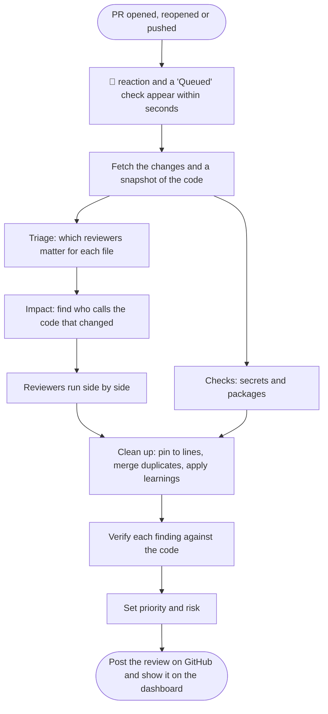

In plain words:

1. **Acknowledge fast.** A 👀 reaction and a check run show up right away, so nobody wonders whether
   it is working.
2. **Read only what matters.** Lockfiles, generated and binary files are skipped. On later pushes
   only the new commits are reviewed. Big pull requests are split into pieces that fit the AI's
   budget.
3. **Triage.** One quick AI call decides which reviewers are worth running on each file. A README
   change does not need a security review; a payment route does.
4. **Impact.** PR Guard looks up every place that uses the functions and types that changed. This is
   how it catches "you changed this signature, and three other files still call the old one".
5. **Review.** The reviewers and checks run in parallel, each on its own files.
6. **Clean up.** Findings are pinned to real diff lines. Two reviewers reporting the same bug become
   one finding with both badges. Anything the team already said is fine is dropped.
7. **Verify.** A stronger AI pass re-reads the code for each important finding. It can confirm it
   (the comment gets a Verified badge and the evidence) or reject it, but a rejection only counts if
   it quotes real code that disproves the finding. If it is unsure, the finding stays.
8. **Rank and post.** Priority and risk are set, and one GitHub review is posted.

Every step, its timing, its cost and the files each AI looked at are saved in the review's
**trace** on the dashboard, so "why did it say that?" always has an answer.

## The reviewers

Each reviewer has one job. Small, focused reviewers catch more than one reviewer told to look for
everything, and each one can be switched off per repository.

| | Reviewer | Catches |
| --- | --- | --- |
| 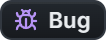 | Bug | Logic errors, wrong conditions, null paths, edge cases nobody handled |
| 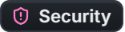 | Security | Missing access checks, injection, unsafe input, data exposure |
| 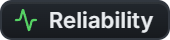 | Reliability | Swallowed errors, missing awaits, races, leaks, calls without timeouts |
| 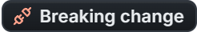 | Breaking change | Changed functions or exports whose callers were not updated |
| 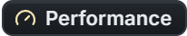 | Performance | Database queries in loops, unbounded reads, repeated heavy work |
|  | Data | Destructive migrations, money stored as floats, missing indexes |
|  | AI slop | Made-up APIs, copied helpers, placeholder logic, dead code |
|  | Team rules | The team's own written rules for the org and the repository |
| 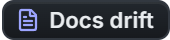 | Docs drift | New settings, routes or flags the docs do not mention |
|  | Test gap | New behavior with no test, plus the tests worth adding |
|  | Secrets *(check)* | Keys, tokens and passwords committed in the code |
|  | Supply chain *(check)* | Malicious or vulnerable packages (npm, PyPI, Go), using Socket |

The two **checks** are plain code, not AI: a leaked key or a known-malware package is a fact, so it
does not need a model's opinion.

It works on any language. We checked it on TypeScript, Python, Go and Java projects.

### Before reviewing, it gets to know the repo

When a repository is connected, PR Guard reads a sample of it and writes a short **brief**: what the
project is, its stack, its structure and its conventions. Every review starts from that brief. The
team can edit it or ask for a fresh one from the dashboard.

Teams can also write **rules** in plain language, once for the whole organization and once per
repository ("never log with `print`", "money is always integer cents"). The Team rules reviewer
enforces them.

## Priority and risk

Two different questions, answered separately:

| | Answers | Based on |
| --- | --- | --- |
| **Priority** (P0 Urgent to P3 Low) | How soon should someone look at this PR? | What the change means for the business (money, sign-in, customer data), its labels such as `hotfix`, and how serious the findings are |
| **Risk** (Low, Medium, High) | How likely is this change to break something? | How big it is, whether it touches sensitive areas such as sign-in or payments, how much other code depends on it, new or malicious packages, removed checks, and what the reviewers found |

Both come with one line of reasons, on GitHub and on the dashboard. Adding or removing a label on
the PR updates the priority.

## Talking to PR Guard in a pull request

Comment on the pull request, or reply under one of PR Guard's line comments:

| Command | What it does |
| --- | --- |
| `@prguard help` | Lists the commands |
| `@prguard review` | Reviews the whole pull request again |
| `@prguard explain` | Explains a finding in more depth (on its comment) |
| `@prguard fix` | Replies with a suggested change you can commit in one click (on its comment) |
| `@prguard ignore <reason>` | Dismisses the finding and remembers why (on its comment) |
| `@prguard <any question>` | Answers a question about the pull request, citing the code |

Answers usually arrive within about ten seconds and point at files and line numbers.

## It learns from the team

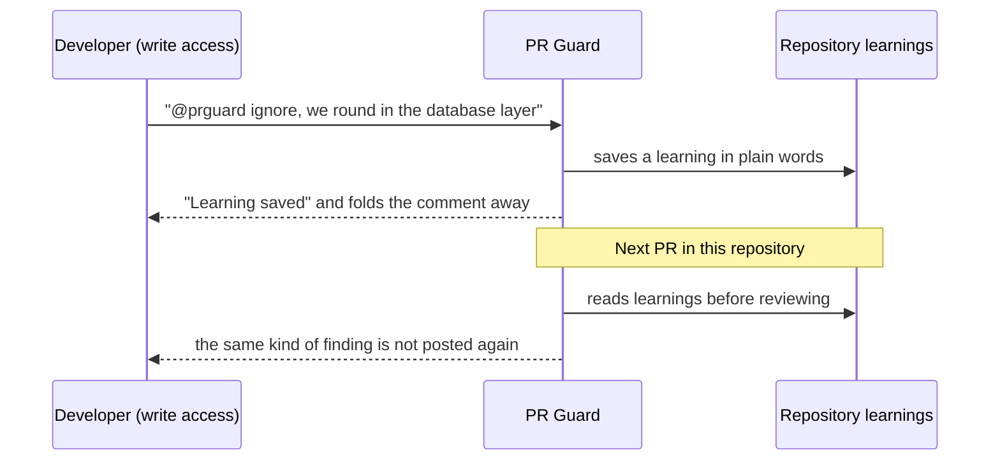

Three ways to teach it, all from inside the pull request:

- `@prguard ignore <reason>` on a finding.
- A 👎 on one of its comments.
- A reply saying the code is intentional ("this is on purpose, the endpoint is internal").

Only people with write access to the repository can teach it, so an outside contributor cannot
teach it to stay quiet. Learnings are listed on the repository page, where they can be added by hand,
paused or deleted.

## It follows up on fixes

When someone pushes again, PR Guard checks whether the code behind each open finding changed. If the
problem is gone, the comment gets a Fixed badge and is folded away, and the check run says so:
`7 open · 1 critical · 2 fixed`. A problem that is still open is not posted a second time.

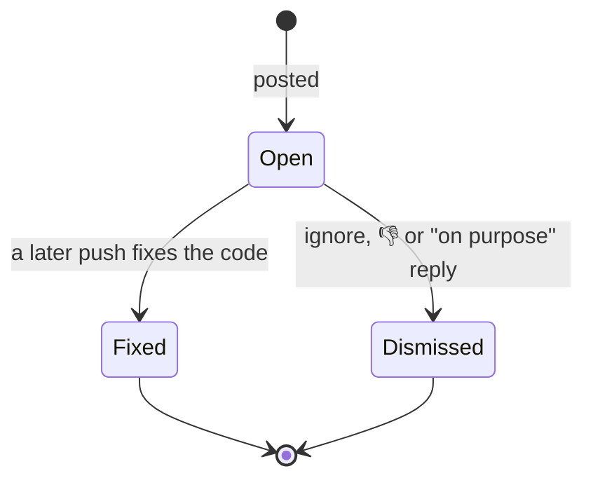

## Busy days: the queue

Every review is saved as a job before it starts, so nothing is lost if the server restarts, and a
failed review is retried. A new push to the same pull request replaces the review that was still
waiting.

Two reviews run at a time. Anything else waits its turn, oldest first, and its check on GitHub reads
**Queued** until it starts. Every AI call also waits for room in a per-minute budget, so a burst of
pull requests slows down a little instead of failing. In our test, four pull requests opened at once
all finished cleanly in under five minutes.

## Secrets stay secret

A committed key is reported on its line, but its value is never repeated: not in comments, not in
the database, not in logs. Anything an AI writes is scrubbed of the exact values the Secrets check
found, and of anything shaped like a known key.

## The dashboard

| Page | What you see |
| --- | --- |
| **Queue** | Open pull requests in P0 to P3 columns, with risk and open findings |
| **Reviews** | Every review, live, filterable by priority |
| **Review** | Findings with severity, reviewer, evidence and status; the step-by-step trace; re-run |
| **Repositories** | Connected repositories; switch reviews on or off |
| **Repository** | The brief, team rules, reviewers on or off, and learnings |
| **Insights** | Number of reviews, median time to review, AI usage, findings by severity, verification results, and per reviewer how many findings were fixed, dismissed or left open |
| **Settings** | Organization-wide rules |

Sign-in is with GitHub, and people only see the repositories GitHub says they can access.

## Why we built it this way

| Choice | Why |
| --- | --- |
| A GitHub App that only comments | Reviews show up where developers already work, and a human stays in charge |
| Many small reviewers instead of one | Focused prompts find more, and the team can switch off what it does not need |
| Check every finding before posting | A noisy reviewer gets ignored; fewer, better findings get read |
| Plain code for secrets and packages | Facts do not need an AI's guess, and these checks are instant and free |
| Groq with two open models (`gpt-oss-20b` for quick calls, `gpt-oss-120b` for careful ones) | Fast and cheap enough to review every push |
| SQLite and an in-process job queue | One small server and one file to back up; plenty for a team, nothing extra to run |
| Image badges | GitHub strips most styling from comments; images keep the look the same in light and dark mode |

## Questions people ask

**What problem does it solve?**
Reviews are slow and tired reviewers miss serious bugs. PR Guard gives every pull request a careful
first pass within minutes.

**Where do existing tools fall short?**

| Tool type | Gap |
| --- | --- |
| Linters, static analysis (ESLint, SonarQube) | Only fixed rules; miss logic and intent |
| Generic AI review bots | One prompt for everything; unchecked, noisy comments |
| Security tools (Dependabot, Snyk, GitGuardian) | Separate alerts, outside the review |

Most of them also don't say which PR to look at first, don't follow up on fixes, and don't show
their reasoning.

**What makes it different?**

- Verifies every important finding against the code before posting.
- Ten focused reviewers instead of one generalist.
- Sees callers outside the diff, so it catches breaking changes.
- Plain code, not AI, for secrets and malicious packages.
- Priority and risk on every PR.
- Learns from the team, tracks fixes, answers questions in the thread.
- Shows its work in a step-by-step trace.

**How does information flow?**

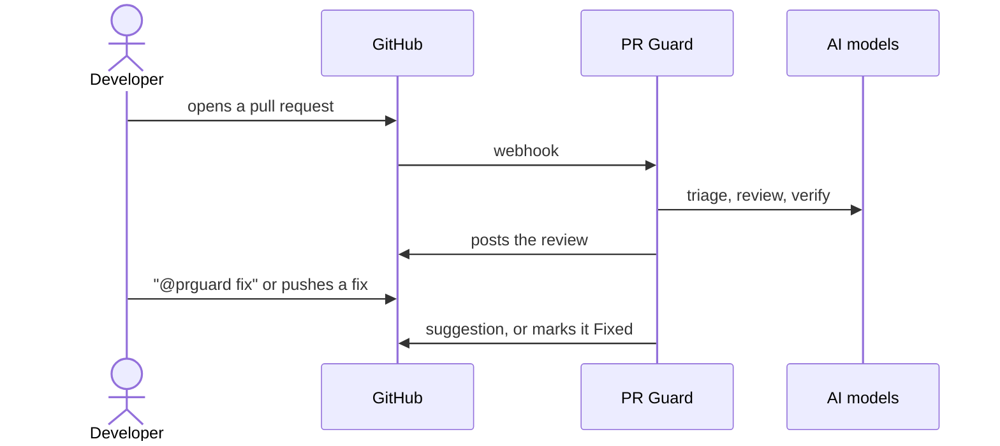

**What is it built with?**
TypeScript on Node.js 24, Hono, SQLite, Next.js 16, Groq (`gpt-oss-20b`, `gpt-oss-120b`), Socket,
Docker on Railway.

**Is the AI always right?**
No. That's why findings are verified, carry evidence, and can be dismissed. A person always decides.

**Speed and cost?**
One to three minutes per review in our runs, about a few cents in AI cost.

**Can it block a merge?**
No. It only comments.

## Adding a reviewer

A reviewer is one file in `apps/api/src/review/reviewers/` and one line in its `index.ts`. Describe
what it looks for in plain language, which files it applies to and which AI model size it uses. It
then gets its own badge, shows up on the dashboard and can be switched on or off per repository.
